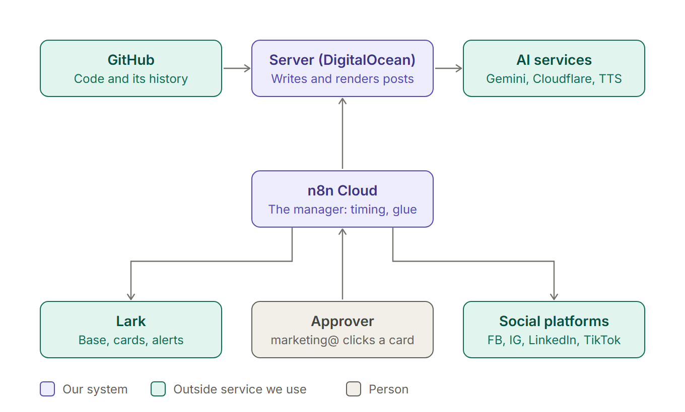
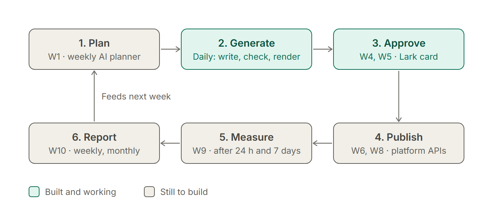
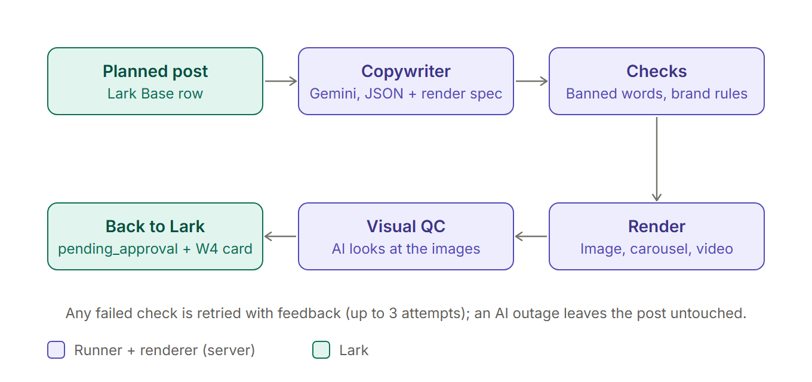
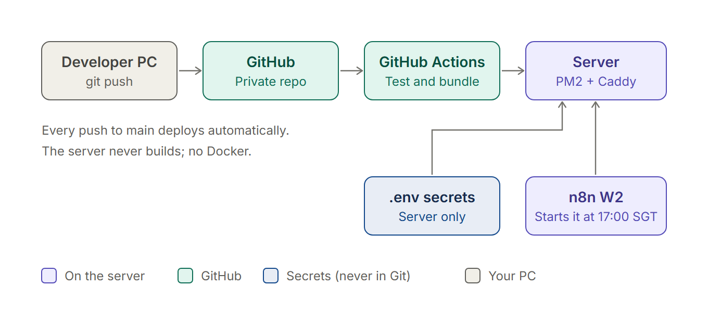

# Linkbot Marketing Automation: Developer Guide

**Version:** 24 Nov 2026 · **For:** developer, supervisor and team lead · **Repo:** `github.com/Linkbot-Developer/marketing-linkbot` (private, company organisation) · **Source of truth:** `docs/marketing-system-spec.md` and `CLAUDE.md` in the repo

## Architecture

- **n8n Cloud** (`flow.linkbot.sg`, shared company instance) orchestrates: schedules, webhooks, Lark cards and alerts, and later publishing and analytics. All marketing workflows are prefixed **`[Marketing]`**, and the build script refuses to touch anything else.
- **The app** runs natively on the droplet (no Docker) and contains:
  - the **renderer**: a Node HTTP API (Playwright/Chromium for images; HyperFrames + FFmpeg for video; Edge TTS for voice)
  - the **runner**: AI agents. Copywriter, Brand Checker and Visual QC, with zod-validated JSON output.
- **Lark** is the database and the UI: the Base (Content, Settings, Reports, Leads), the IM bot (cards and alerts) and Drive.
- **AI:**
  - text: Gemini free tier (`AI_TEXT_PROVIDER=gemini`); Claude (`claude-opus-5-5`) is implemented and switches on with one setting
  - images: Cloudflare Workers AI (FLUX)
  - voice: Edge TTS

## The post lifecycle and statuses

Statuses (field `status` in Content):
- `planned` → `generating` → `pending_approval` → `approved` → `scheduled` → `published`
- `pending_approval` → `rejected` (reason saved) → back to `generating` with the feedback
- Past `approval_deadline` and not approved → `skipped` (W7)
- AI checks failed `max_generation_attempts` times → `failed` (alert)
- An AI outage or used-up quota leaves the post as it was (`planned` or `rejected`), never `failed`

## Generation pipeline (runner)

1. Read the `planned` and `rejected` rows (earliest first) and the Settings.
2. **Copywriter** (Gemini, JSON mode) returns the caption, hashtags, CTA link and a **render spec** (image, carousel, story or reel).
3. **Deterministic guard:** banned words (instant, guarantee, prices, American spellings…), then the **Brand Checker** agent.
4. **Render** through the renderer API, then **Visual QC** (a vision model checks for logos, clocks, garbled text and off-brand colours). It retries up to 3 renders, then rewrites.
5. Upload the previews to the Base, set `pending_approval`, and call the **W4 webhook** so the card goes out at once.

**Free-quota planning:**
- The Gemini free tier allows 20 requests per model per day; with 4 models that's about 80. It resets at midnight US Pacific time.
- `runner/out/ai-usage.json` counts the calls. Each run takes only as many posts as fit: (requests left − reserve) ÷ about 5.
- Settings row `ai_quota` controls this. The weekly plan of 11 posts needs about 55 requests, against about 530 a week.

## n8n workflows
- **W4 Send approval card:** the runner webhook, plus an hourly backup at :05. Posts with `pending_approval` and no card get one in the approval group (Settings `approval_chat`). ✅
- **W5 Handle approval:** the Lark card callback.
  - Acknowledges within 3 s, then checks the click is from the approver open_id, on the latest card, while still pending.
  - Updates the post and turns the card green, red or orange.
  - Other users get a reply in the card's thread. ✅
- **W7 Deadline guard:** hourly at :35. Overdue posts become `skipped`, their card is greyed out and the group is told. ✅
- **W11 Error alerts:** the Error Trigger. Every `[Marketing]` workflow names it, and failures post to Settings `alerts_chat`. ✅
- **W2 Daily generation:** every day at 17:00 SGT, calls the server's `POST /jobs/daily` with the renderer key (n8n credential). "Started" or "already running" is fine; anything else alerts through W11. **Off until the server is live.**
- **To build:** W1 Plan week · W6 Schedule · W8 Publish · W9 Analytics · W10 Reports · W12 Token maintenance.

The workflows are code: `n8n/build.mjs` creates or updates them through the n8n API and exports git-safe copies to `n8n/workflows/`. Don't edit them by hand in the n8n UI; change `build.mjs` and redeploy (`node n8n/build.mjs`).

## Deployment

- **Server:** DigitalOcean, Ubuntu 24.04, Singapore, its own droplet. **1 vCPU / 1 GB to start** plus a 2 GB swap file; resize to 2 GB only if video renders struggle. Installed natively, without Docker:
  - **PM2** keeps the renderer running on `127.0.0.1:8787` and restarts it after a reboot.
  - **Caddy** provides automatic HTTPS at `renderer.linkbot.sg`.
  - **No server cron:** n8n **W2** calls `POST /jobs/daily` at **17:00 Singapore time**, and the renderer runs `deploy/run-daily.sh` (locked, so runs never overlap).
- **Set up once:** `deploy/server-setup.sh`. It installs the security updates, swap, firewall, a `hex` user with SSH keys only, Node 22, PM2, FFmpeg, Edge TTS, Chromium's libraries and Caddy. Full steps are in `docs/deploy.md`.
- **Deploying is automatic (CI/CD):** every push to `main` runs GitHub Actions (`.github/workflows/deploy.yml`). It installs and tests the code, bundles it, copies the bundle to the droplet, reloads PM2 and checks `/health`. **The server never builds**, which is why 1 GB is enough. Start and result notifications go to n8n.
- **Secrets:** `/srv/marketing-linkbot/.env` is created by hand once, shared privately. Deploys never replace it, and refuse to run without `RENDERER_API_KEY`.
- **Renderer API** (Bearer `RENDERER_API_KEY`):
  - `GET /health`
  - `POST /render/{image,carousel,story,reel}`
  - `GET /files/<job>/<name>`
  - `POST /jobs/daily` (start today's generation; 202, or 409 if running) · `GET /jobs/<id>` (status and log tail)
- **Until the server exists:** the Windows scheduled task "Linkbot Marketing - Daily generation" runs `scripts/daily-run.ps1` at 16:30 PC time. **On switch-over day, switch on W2, then disable the PC task**: each machine has its own quota counter, so running both would spend the free AI quota twice.

## Security
- **Secrets live only in `.env`** (git-ignored) and in n8n credentials: the Lark app secret, the AI keys and the webhook secret. They're never in workflow JSON, docs, logs or chat.
- **Webhooks:** the paths contain a random secret. Card clicks are accepted only from the approver's Lark open_id, on the card ID stored on the post.
- **Renderer:** it listens only on `127.0.0.1` and refuses to start in production without an API key, so it's reachable only through Caddy (HTTPS). SSH is key-only, with root login off.
- **Publishing:** approval-only, plus the pause switch (`pause_publishing`) and the deadline guard.

## Repo map
- `CLAUDE.md`: brand, tone, audience and compliance (read by the agents).
- `agents/`: the instructions for each AI agent.
- `runner/`: the generation pipeline (`npm run daily`).
- `renderer/`: the media API.
- `templates/`: the HTML designs.
- `n8n/`: workflows as code.
- `deploy/`: the server set-up script, PM2 config, Caddyfile and daily-run script.
- `.github/workflows/deploy.yml`: CI/CD.
- `docs/`: the spec, Lark permissions, the workspace map and these guides.

## Operations
- **Logs:**
  - renderer: `pm2 logs linkbot-renderer` (status: `pm2 status`; memory: `pm2 monit`, `free -m`)
  - daily runs: `/srv/marketing-linkbot/logs/runner.log` and W2's executions in n8n (run now: `FORCE=1 deploy/run-daily.sh`)
  - deploys: the GitHub Actions tab
  - n8n: the executions list for each workflow
- **Alerts:** the Marketing Alerts group (n8n failures and runner problems).
- **Settings (no code needed):** pause_publishing, posts_per_week, posting_times, approval_lead_hours, max_generation_attempts, ai_quota, approver, approval_chat, alerts_chat, agent_switches.

## Open items and decisions
- Server approval and set-up. After the first deploy, render one reel to confirm video works on 1 GB.
- Developer apps for Meta, LinkedIn and TikTok (needed for W8 publishing).
- Claude API billing (optional): stricter checks and no daily cap.
