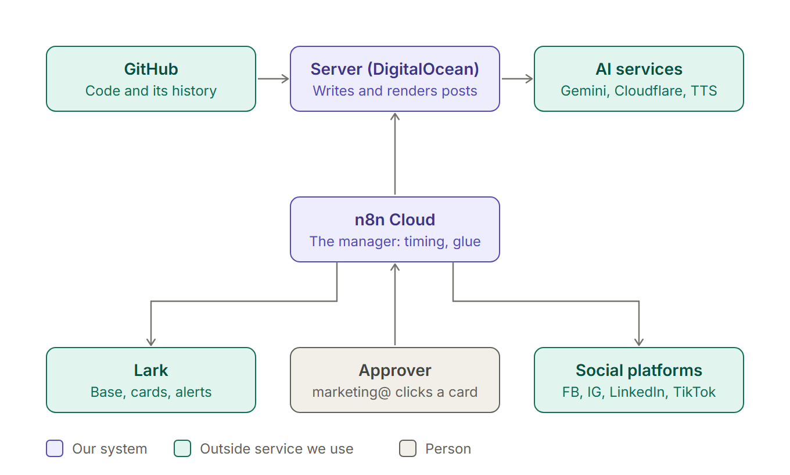
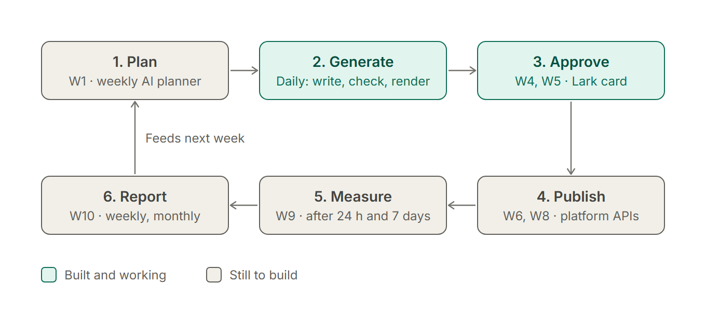

# Linkbot Marketing Automation: Management Guide

**Version:** 24 Nov 2026 · **For:** management and the marketing team · **Status:** in testing (test social accounts)

## In one sentence
The system plans, writes and designs Linkbot's social media posts with AI, sends each one to the marketing approver in Lark, and (once publishing is connected) posts it at the right time and reports back on results. **Nothing is ever published without a person's approval.**

## Why we built it
- **Consistency:** 11 posts a week across LinkedIn, Instagram, Facebook and TikTok, without the team writing and designing each one by hand.
- **On-brand by default:** every post is checked against Linkbot's brand rules (British English, approved offers, no prices, no exaggerated claims, brand colours) before anyone sees it.
- **Built for our targets:** every post links back with tracking, so we can see which content brings **valid leads (target: 10 a week)** and **consultations (target: 10 a month)**.
- **Low running cost:** it runs mainly on free tools. See "What it costs" below.

## Who does what

- **Lark** is where people work. The **Base "Linkbot Marketing Automation"** holds every post, its status and preview, plus a **Settings** dashboard. The **Marketing Alerts** group receives approval cards and warnings.
- **n8n** is the "manager". It decides when things happen and connects all the tools.
- **The server** is the "workshop". It writes, checks and designs the posts. *Until the server is ready, a team PC does this every afternoon.*
- **AI services** do the writing (Gemini), photos (Cloudflare) and voice-overs.
- **GitHub** safely stores the system's code and every change to it.
- **The approver (marketing@linkbot.sg)** is the only person who can approve a post.

## The life of a post

1. **Plan (weekly).** Next week's posts are planned in the Base: topic, platform, format and time, following our content mix (Educate 40%, Prove 20%, Show 20%, Engage 10%, Promote 10%).
2. **Generate (daily).** AI writes each post and designs the image, carousel or short video. Automatic checks look for brand-rule breaches and image problems, such as stray logos or garbled text, and fix them before anyone sees the post.
3. **Approve.** A card appears in the Marketing Alerts group with the preview, caption and three buttons: **Approve**, **Reject with feedback** or **Regenerate**. A rejected post is rewritten using the feedback and sent again.
4. **Publish.** At the planned time, the post goes out on the platform with the AI-content label switched on.
5. **Measure.** One day and one week after posting, reach, engagement, clicks and views are saved against the post.
6. **Report.** A weekly report and a monthly report compare results with our lead and consultation targets. Their recommendations shape the next week's plan.

## Safety and control
- **Approval only:** nothing is published without the approver's click. Other people in the group can see the cards, but their clicks are refused.
- **Deadline:** a post not approved by 24 hours before its time is **skipped**, never published by default.
- **Pause switch:** one setting in the Base (`pause_publishing`) stops all publishing at once.
- **Alerts:** if any part fails, a message appears in the Marketing Alerts group.
- **Honest content:** AI-made images and videos are labelled as AI-generated on each platform. No invented statistics, fake testimonials or prices.
- **Secrets:** passwords and keys are kept only on the server and in n8n, never in documents or code.

## Where things stand (24 Nov 2026)
**Working now**
- Brand rules, audience and tone set up for the AI (from the master brief and brand kit).
- Lark workspace, Base, wiki and Marketing Alerts group.
- Post generation: copy, images, carousels and 15–20 second videos with a voice-over.
- Approval cards with Approve, Reject and Regenerate, deadline skipping, and error alerts.
- First test week (week 49): posts are being generated and approved.

**Next**
- Move the "workshop" onto the company server, so it no longer depends on a PC.
- Automatic weekly planning.
- Publishing to the four platforms. This needs each platform's developer access.
- Results tracking, then the weekly and monthly reports.
- Later: blog articles, lead tracking from enquiries, and paid ads.

## What we need from management
1. **Server approval:** a small DigitalOcean server (Singapore), about **US$6 a month** to start (US$12 if videos need more memory), and the subdomain `renderer.linkbot.sg`. The set-up and automatic deployment are ready.
2. **Platform access:** developer apps for Meta (Facebook and Instagram), LinkedIn and TikTok, starting with the test accounts. Then a decision on when to switch to the live company accounts.
3. **Optional, later:** a payment card for the Claude AI API (about US$10–20 a month estimated) for stricter checking and higher limits. The free AI tier works for now, within daily limits.

## What it costs (estimate)
- **AI writing and checking:** free tier now. Claude is optional later, at about US$10–20 a month.
- **AI images and voice-overs:** free.
- **Server:** about US$6 a month to start, or US$12 if needed (pending approval).
- **n8n and Lark:** existing company subscriptions.

## How to use it day to day
- **Approve posts:** open the card in the **Marketing Alerts** group. To reject, type what should change, then press **Reject with feedback**.
- **See all posts:** open the Base **Linkbot Marketing Automation** → **Content** (calendar, board and "needs approval" views).
- **Change the plan:** in **Settings** you can change posts per week, posting times, the approver, or pause publishing. No code is needed.
